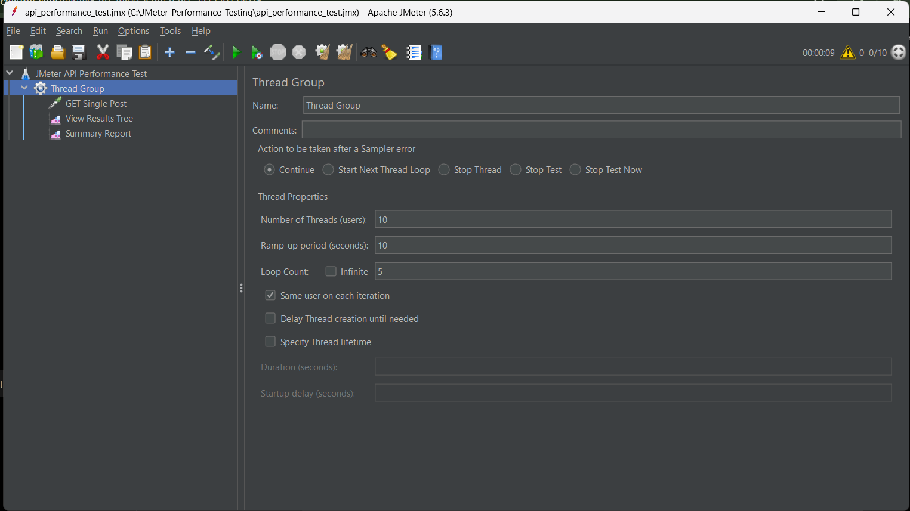
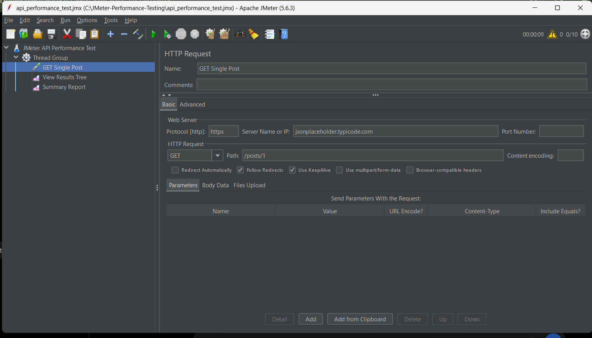
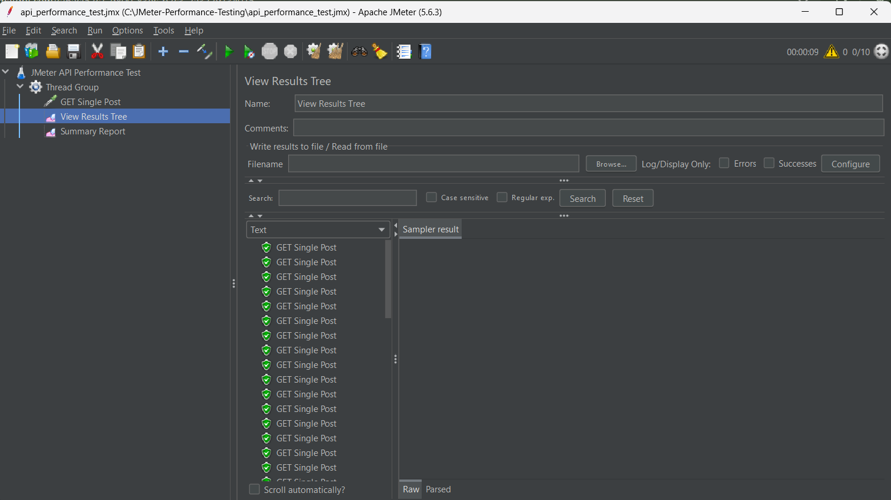

# BÁO CÁO KIỂM THỬ HIỆU NĂNG BẰNG APACHE JMETER

## 1. Giới thiệu

Bài thực hành nhằm tìm hiểu và sử dụng Apache JMeter để kiểm thử hiệu năng API thông qua giao thức HTTP/HTTPS.

Các mục tiêu:
- Tạo kịch bản kiểm thử bằng JMeter.
- Mô phỏng nhiều người dùng gửi yêu cầu đến API.
- Theo dõi thời gian phản hồi và tỷ lệ lỗi.
- Phân tích kết quả qua Summary Report.

## 2. Môi trường thực hiện

- Hệ điều hành: Windows.
- Apache JMeter: 5.6.3.
- Java: OpenJDK Temurin 25.0.4.
- API: https://jsonplaceholder.typicode.com/posts/1
- Phương thức HTTP: GET.

## 3. Thiết kế kịch bản kiểm thử

### 3.1. Thread Group

- Number of Threads: 10.
- Ramp-up Period: 10 giây.
- Loop Count: 5.
- Tổng số yêu cầu dự kiến: 50.

### 3.2. HTTP Request

- Protocol: HTTPS.
- Server Name: jsonplaceholder.typicode.com.
- Method: GET.
- Path: /posts/1.

### 3.3. Công cụ theo dõi kết quả

- View Results Tree: xem kết quả từng yêu cầu.
- Summary Report: tổng hợp các chỉ số hiệu năng.

## 4. Kết quả kiểm thử

### 4.1. Cấu hình Thread Group

### 4.2. Cấu hình HTTP Request

### 4.3. Kết quả từng yêu cầu

### 4.4. Summary Report

### 4.5. Bảng thống kê

| Chỉ số | Kết quả |
|---|---:|
| Tổng số yêu cầu | 50 |
| Average | 103 ms |
| Min | 55 ms |
| Max | 804 ms |
| Std. Dev. | 110.43 ms |
| Error % | 0.00% |
| Throughput | 5.3 requests/sec |

### 4.6. Nhận xét

Trong lần kiểm thử này, JMeter ghi nhận 50 yêu cầu và tỷ lệ lỗi là 0.00%. Thời gian phản hồi trung bình là 103 ms, nhỏ nhất là 55 ms và lớn nhất là 804 ms.

Kết quả cho thấy các yêu cầu không bị đánh dấu lỗi trong lần chạy này. Tuy nhiên, thời gian phản hồi có dao động và kết quả chỉ phản ánh điều kiện kiểm thử tại thời điểm thực hiện. Cần kiểm thử thêm với nhiều mức tải và trong nhiều lần chạy để đánh giá toàn diện hơn.

## 5. Kết luận

Qua bài thực hành, em đã làm quen với Apache JMeter, biết cách tạo Thread Group, cấu hình HTTP Request, thực hiện kiểm thử API và đọc các thông số trong Summary Report.

## 6. Hướng phát triển

- Thử nghiệm nhiều endpoint khác nhau.
- Tăng dần số lượng người dùng để so sánh.
- Bổ sung Assertion để kiểm tra dữ liệu phản hồi.
- Tạo báo cáo HTML để phân tích hiệu năng chi tiết hơn.